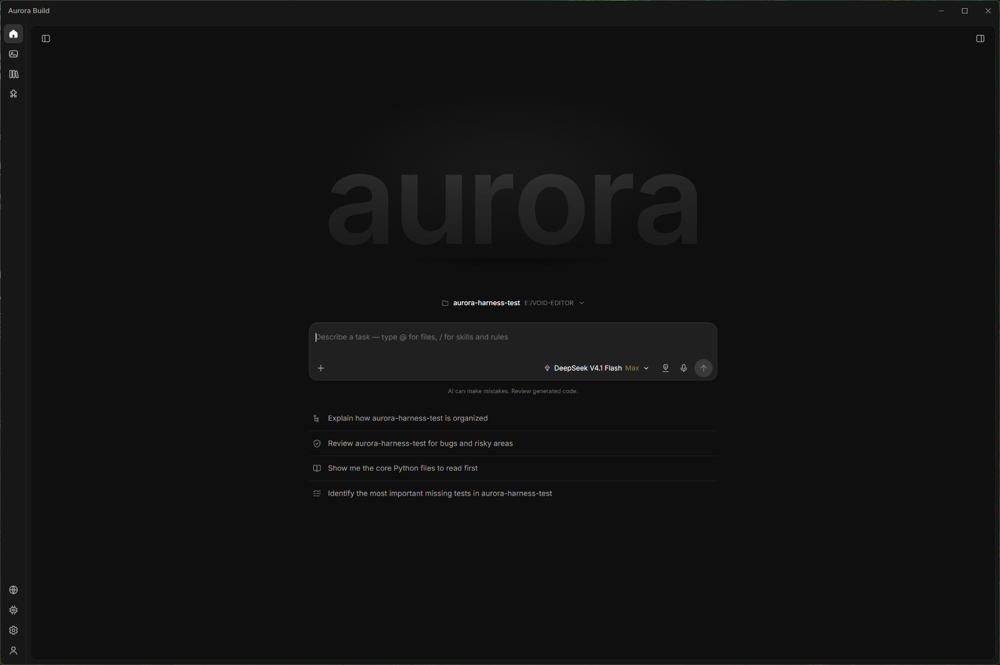

# Aurora

An agentic coding IDE. One window is a conversation with an agent that reads,
edits, runs, browses, delegates and reports; the other is a real editor. Both
work on the same project, and a Rust engine underneath owns everything the
agent does.

<div align="center">

[](https://github.com/Aurora-LABS-Ai/aurora-ide/releases/latest)
[](LICENSE)
[](https://tauri.app)
[](https://github.com/Aurora-LABS-Ai/aurora-ide/releases/latest)

</div>

<div align="center">



*The Agent Window: pick a project, pick a model, describe the task.*

</div>

## What it is

| Window | What you do there |
|--------|-------------------|
| **Agent Window** | Talk to the agent, watch it work, review diffs, drive a browser, run terminals, keep sub-agents in view |
| **IDE** | Explorer, Monaco editor, terminal, Git, themes |

The Agent Window is the product. The IDE is the editor beside it. Rust owns the
agent turn loop, the provider adapters, 51 native tools, sessions, checkpoints,
MCP, the code index, the terminal shells and the browser WebViews. React draws
the two interfaces.

**Modes.** Agent (full tools), Plan (read, then write a plan, no edits) and
Chat (a plain assistant with memory, images and video, no workspace).

**Providers.** Anthropic, OpenAI (Chat and Responses), DeepSeek, Fireworks,
GLM (Z.AI), Meta, MiniMax, Kenari, Volcano Ark, Modal, LM Studio and Ollama,
plus sign-in providers: Claude Code, Codex (ChatGPT), Cursor, Antigravity,
OpenCode Go, CommandCode, Atlas Cloud and AgentRouter. Any OpenAI-compatible
endpoint works as a custom row. Every chat keeps its own model.

## What the agent can do

- **Read, search, edit, run.** Line-numbered reads, exact-text edits, glob and
  grep, a shell with background processes, and a Terminal panel it can open,
  type into and read back like a person.
- **See the code.** A local tree-sitter index for 14 languages (definitions,
  usages, outlines, ranked source search, a repo map on the first message).
  No embeddings, no model, nothing leaves the machine.
- **Drive a browser.** A native WebView it can navigate, click, fill, scroll,
  screenshot and inspect, with real input events, a phone viewport and an
  activity halo so you can see what it is doing.
- **Delegate.** Sub-agents with their own conversation and tool roster run in
  the background; the parent gets each report as a message, can answer a
  child's question mid-run, and sees every running agent's last steps on each
  of its own tool results.
- **Keep you in the loop.** Work cards fold a long tool-heavy turn into one
  live window, an approval gate asks before risky tools, a checklist tracks
  the plan, and a git checkpoint per message lets you rewind the workspace.
- **Use your servers and skills.** MCP over stdio, Streamable HTTP and SSE
  (global and per-project configs), plus skills and rules from the project.
- **Answer with more than prose.** Live canvases, inline pickers and diagrams
  drawn in the reply, link cards, and structured layouts when the answer
  calls for them.
- **Hear you.** Dictation runs out of process against a runtime you point it
  at: CrispASR when you stop, Phonon-2 as you speak.

## Install

Windows 10/11 x64. Download the `.msi` (recommended) or the NSIS `.exe` from
[Releases](https://github.com/Aurora-LABS-Ai/aurora-ide/releases/latest) and run
it. The installer carries the WebView2 bootstrapper, needs nothing installed
first, and puts the `aurora` and `agw` commands on your PATH.

**First launch:** Settings → Providers (an API key, a sign-in, or local
LM Studio / Ollama), add a project folder, then describe a task.

## The engine without the window

The same Rust core runs headless. `aurora serve` starts the engine with no
window and serves the Agent Window to a browser, with password sign-in, so a
Linux box or a second machine can host it. The desktop app can also open its
own running engine in a browser from the icon rail. This is early: the
browser gets the conversation surface, the desktop keeps the desktop-only
parts (voice, clipboard, native dialogs). `aurora agent "task"` hands a task to
a running Agent Window from a terminal, and Aurora can be an MCP server other
agents drive.

## Build from source

**Prerequisites:** Node 22, [pnpm](https://pnpm.io) 9+, Rust **1.92.0**
(pinned in `rust-toolchain.toml`), and the
[Tauri 2 OS prerequisites](https://v2.tauri.app/start/prerequisites/).

```bash
pnpm install
pnpm tauri:dev          # full app (the first Rust build is slow)
```

```bash
# macOS / Linux
./scripts/setup.sh

# Windows PowerShell
.\scripts\setup.ps1
```

| Command | What it does |
|---------|----------------|
| `pnpm dev` | Frontend only, on http://localhost:5273 |
| `pnpm test` | Vitest |
| `pnpm lint` | ESLint |
| `pnpm tauri:build` | Desktop installers (`.msi` and NSIS `.exe`) |
| `pnpm tauri:build:fast` | A faster local release build for testing |
| `cargo test --lib` (in `src-tauri`) | The Rust tests |
| `pnpm crispasr:package` | Zip a CrispASR runtime folder for sharing |

Full walkthrough: [DOCS/GETTING-STARTED.md](DOCS/GETTING-STARTED.md).
IDE theme tokens: [DOCS/theme-dev.md](DOCS/theme-dev.md).

## Stack

React 18, TypeScript, Vite 8 and Zustand on the front; Tauri 2 and Rust 2021
behind it, with SQLite for settings and providers and JSONL for conversations,
under `%LOCALAPPDATA%\AuroraIDE\` on Windows (the equivalent app-data root
elsewhere). The Agent Window is token CSS with no utility framework; the IDE
uses Tailwind.

## Built with AI

Aurora is built by one person directing AI coding agents. The models that
wrote this project are Claude Fable 5.1, Claude Opus 5 and 5.5, and ChatGPT's
Sol 6 and 6.1 through Codex. Every change still goes through the same bar:
tests, a live run, and a human deciding what ships.

## Status

Source-available, small team. **Please do not open issues for bugs or feature
requests right now.** The tracker is intentionally quiet.

## License

[Aurora Source-Available License](LICENSE): personal and non-commercial use.
Commercial, enterprise, or hosted use needs written permission.

---

<div align="center">

[Getting started](DOCS/GETTING-STARTED.md) · [Aurora Labs](https://github.com/Aurora-LABS-Ai)

</div>
