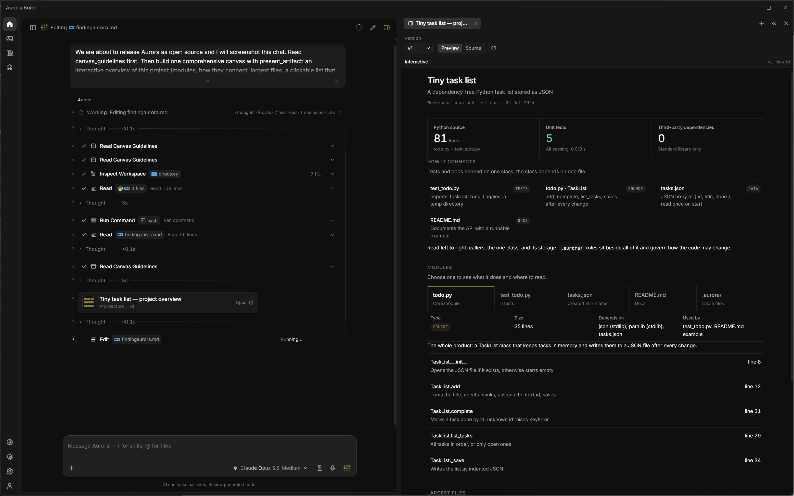
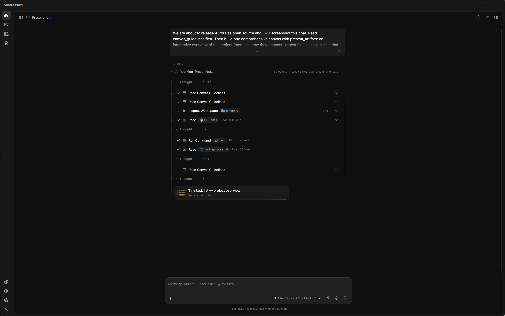
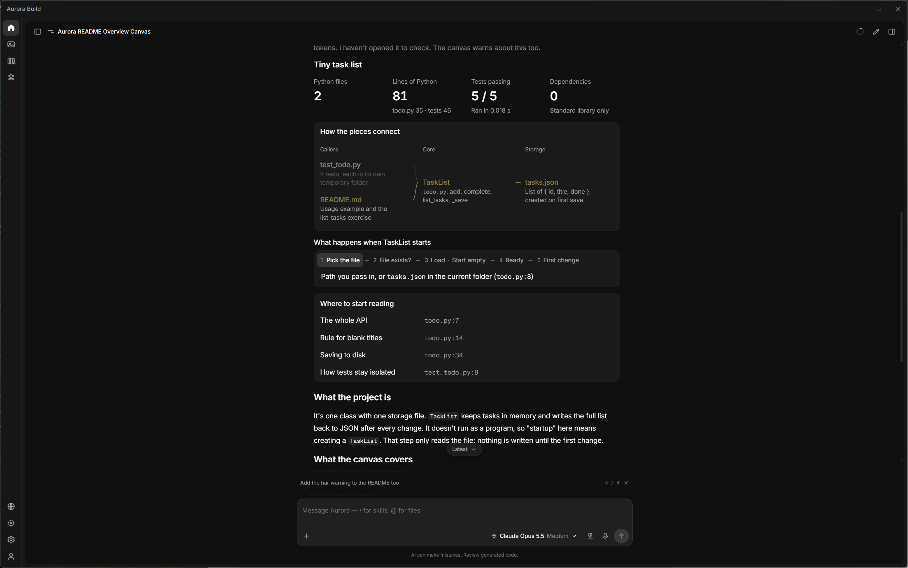

# Aurora

An agentic coding IDE. One window is a conversation with an agent that reads,
edits, runs, browses, delegates and reports; the other is a real editor. Both
work on the same project, and a Rust engine underneath owns everything the
agent does.

<div align="center">

[](https://github.com/Aurora-LABS-Ai/aurora-ide/releases/latest)
[](LICENSE)
[](https://tauri.app)
[](https://github.com/Aurora-LABS-Ai/aurora-ide/releases/latest)

</div>

<div align="center">


*The Agent Window: pick a project, pick a model, describe the task.*

</div>

## What it is

| Window | What you do there |
|--------|-------------------|
| **Agent Window** | Talk to the agent, watch it work, review diffs, drive a browser, run terminals, keep sub-agents in view |
| **IDE** | Explorer, Monaco editor, terminal, Git, themes |

The Agent Window is the product. The IDE is the editor beside it. Rust owns the
agent turn loop, the provider adapters, 51 native tools, sessions, checkpoints,
MCP, the code index, the terminal shells and the browser WebViews. React draws
the two interfaces.

**Modes.** Agent (full tools), Plan (read, then write a plan file, no edits) and
Chat (a plain assistant with memory, images and video, no workspace). Each chat
keeps its own model and mode.

<div align="center">



*The agent explored a project, then presented an interactive overview of it in the dock.*

</div>

## What the agent can do

- **Files and search.** Line-numbered reads (pictures reach vision models as
  pictures), exact-text edits, whole-file writes, move, delete, glob, grep, a
  workspace tree, and web search with paged page fetch. An existing file has
  to be read before it is edited.
- **Shell and terminals.** Foreground commands; background processes it can
  read, stop, and ask to be woken by; and a Terminal panel it can open, type
  into, send keys to, read and close, like a person at the keyboard. Shell
  profiles are yours to register and check.
- **See the code.** A local tree-sitter index for 14 languages: definitions,
  usages, outlines, ranked source search, and a repo map on the first message.
  No embeddings, no model, nothing leaves the machine. Each project can turn it
  off.
- **Drive a browser.** A native WebView with 19 tools: navigate, view,
  screenshot, click, fill, type, press keys, hover, scroll, wait for a
  condition, run script, read the accessibility tree and the console, set a
  phone viewport, emulate media. Input is real input through the WebView2
  DevTools channel, with an activity halo so you can see what it is doing.
- **Plans and checklists.** Plan mode writes a plan into `.aurora/plans/` and
  cannot edit. Agent mode ticks plan steps and keeps a task checklist you can
  watch in the header.
- **Delegate.** Sub-agents with their own conversation and tool roster:
  general-purpose, explore, reviewer, researcher, verifier, plus your own
  definitions as files in `~/.aurora/agents/`. They run in the background and
  report back as messages; a child can ask its parent a question mid-run; the
  parent sees every running agent's last steps on each of its own tool results.
- **Use your servers and skills.** MCP over stdio, Streamable HTTP and SSE,
  from `~/.aurora/mcp.json` and a project `.mcp.json` (project servers stay
  off until you turn them on). Skills from `.aurora/skills`, `.agents/skills`
  and a global folder, ten loaded at once and the rest reachable by search.
  Project rules from `.aurora/*.md`.
- **Keep you in the loop.** A git checkpoint per message with workspace
  rewind, per-file undo, a diff Review panel, an approval gate with Auto, Ask
  or Deny per tool, pre-save syntax validation, and a three-step file scope.
  Work cards fold a long tool-heavy turn into one live window.
- **Answer with more than prose.** Live canvases (React, diagrams, reports,
  images), inline canvases drawn inside the reply, and a reply layout language
  for facts, flows, diagrams and tables.
- **Aurora Chat.** A mode with no workspace: a memory the model can search and
  write and you can read and edit in the Memory panel, image generation and
  editing, video generation. The Images page makes pictures with no chat model
  in the loop; the Library lists everything generated, pasted or uploaded.
- **Hear you.** Dictation runs out of process against a runtime you point it
  at: CrispASR when you stop, Phonon-2 as you speak.
- **File bugs on itself.** The agent can report an Aurora problem it hits to a
  file you read in Settings → Diagnostics.

<div align="center">



*A turn in progress: the work card keeps every thought, tool call and result in one place.*



*The same project explained with the reply layout: stats, a diagram, a flow, and where to start reading.*

</div>

## Providers

**API key.** Anthropic, OpenAI (Chat and Responses), DeepSeek, Fireworks, GLM
(Z.AI), Meta, MiniMax, Kenari, Volcano Ark, Modal (one row per workspace),
Atlas Cloud, AgentRouter, and any custom row on an OpenAI-compatible,
Responses or Anthropic-compatible endpoint.

**Sign in with a subscription.** Claude Code (claude.ai, several accounts),
Codex (ChatGPT, shares the Codex CLI sign-in), Cursor (Cursor's own browser
sign-in), Antigravity (Google account, several accounts), OpenCode Go and
Command Code (a key, with plan headroom shown).

**Local.** LM Studio and Ollama.

Every provider can carry backup keys, custom headers, extra request parameters
and model aliases. Model facts (context window, output limit, pricing,
reasoning levels) fill in from models.dev and stay editable. Subscription
cards show the plan's usage where the vendor reports it.

## Settings worth knowing

- **Tools → Access.** Project only, Read anywhere, or Full access. Full access
  also turns off the shell command guards and approves every tool.
- **Tools → Per-tool approval.** Auto, Ask or Deny for each shell, file-change
  and browser tool.
- **Agent → Global instructions.** Up to eight named sets, one active, sent
  with every turn.
- **Agent → Context compaction.** Compact at 50 to 95 percent of the window, a
  summary of 4k to 24k tokens, and an optional different model for the summary.
- **Agent → Sub-agents and Code index.** One switch and a default model for
  sub-agents; per-project index on and off, automatic builds, result limits,
  and the saved indexes you can delete.
- **Preferences → Transcript.** Work cards, one live line for tool calls, the
  timeline spine, reply layout and chapters (the last two change what the
  agent is told to write, so they are off by default).
- **Preferences → Composer.** Local autocorrect, word completion and next-word
  prediction, a prompt-refine button, quick replies, voice input.
- **Preferences → Chat titles.** Off, a local GGUF model, or a cloud model.
- **Profile.** A local usage ledger: tokens, cache reads, requests, cost at
  list prices, a weekday-by-hour rhythm, and a ledger by model, provider,
  project and tool. Nothing is uploaded.
- **Command center.** Ctrl+K by default, rebindable.

## Install

Windows 10/11 x64. Download the `.msi` (recommended) or the NSIS `.exe` from
[Releases](https://github.com/Aurora-LABS-Ai/aurora-ide/releases/latest) and run
it. The installer carries the WebView2 bootstrapper, needs nothing installed
first, and puts the `aurora` and `agw` commands on your PATH.

**First launch:** Settings → Providers (an API key, a sign-in, or local
LM Studio / Ollama), add a project folder, then describe a task.

## The engine without the window

The same Rust core runs headless. `aurora serve` starts the engine with no
window and serves the Agent Window to a browser on this machine only
(127.0.0.1), signed in with a one-time link or a password set with
`aurora serve password`. Reach it from another machine through an SSH tunnel
or a reverse proxy of your own. A gauge on the rail shows the engine machine's
CPU, memory, disk and GPU. This is early: the browser gets the conversation
surface, the desktop keeps the desktop-only parts (voice, clipboard, native
dialogs).

From a terminal, `aurora agent "task" --follow` hands a task to Aurora and
streams the transcript back; it works before Aurora is open, because the task
waits on disk. `aurora models`, `threads`, `watch`, `tasks` and `cancel`
inspect and stop work, and `aurora tui` is a terminal front end. `aurora mcp`
runs Aurora as an MCP server other agents can drive, off by default.

## Build from source

**Prerequisites:** Node 22, [pnpm](https://pnpm.io) 9+, Rust **1.92.0**
(pinned in `rust-toolchain.toml`), and the
[Tauri 2 OS prerequisites](https://v2.tauri.app/start/prerequisites/).

```bash
pnpm install
pnpm tauri:dev          # full app (the first Rust build is slow)
```

```bash
# macOS / Linux
./scripts/setup.sh

# Windows PowerShell
.\scripts\setup.ps1
```

| Command | What it does |
|---------|----------------|
| `pnpm dev` | Frontend only, on http://localhost:5273 |
| `pnpm test` | Vitest |
| `pnpm lint` | ESLint |
| `pnpm tauri:build` | Desktop installers (`.msi` and NSIS `.exe`) |
| `pnpm tauri:build:fast` | A faster local release build for testing |
| `cargo test --lib` (in `src-tauri`) | The Rust tests |
| `pnpm crispasr:package` | Zip a CrispASR runtime folder for sharing |

Full walkthrough: [DOCS/GETTING-STARTED.md](DOCS/GETTING-STARTED.md).
IDE theme tokens: [DOCS/theme-dev.md](DOCS/theme-dev.md).

## Stack

React 18, TypeScript, Vite 8 and Zustand on the front; Tauri 2 and Rust 2021
behind it, with SQLite for settings and providers and JSONL for conversations,
under `%LOCALAPPDATA%\AuroraIDE\` on Windows (the equivalent app-data root
elsewhere). The Agent Window is token CSS with no utility framework; the IDE
uses Tailwind.

## Built with AI

Aurora is built by one person directing AI coding agents. The models that
wrote this project are Claude Fable 5.1, Claude Opus 5 and 5.5, and ChatGPT's
Sol 6 and 6.1 through Codex. Every change still goes through the same bar:
tests, a live run, and a human deciding what ships.

## Status

Source-available, small team. **Please do not open issues for bugs or feature
requests right now.** The tracker is intentionally quiet.

## License

[Aurora Source-Available License](LICENSE): personal and non-commercial use.
Commercial, enterprise, or hosted use needs written permission.

---

<div align="center">

[Getting started](DOCS/GETTING-STARTED.md) · [Aurora Labs](https://github.com/Aurora-LABS-Ai)

</div>
