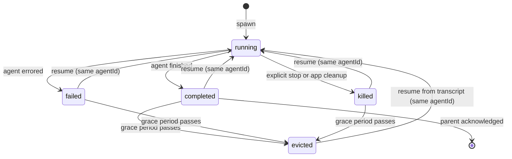
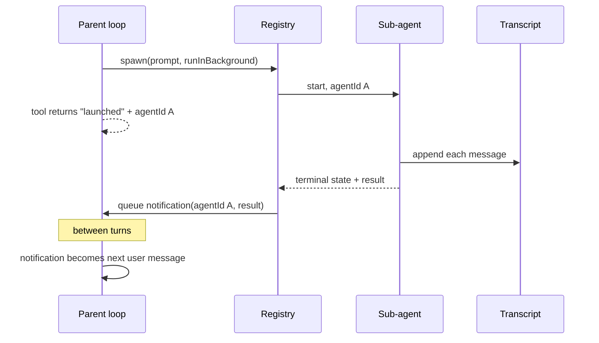
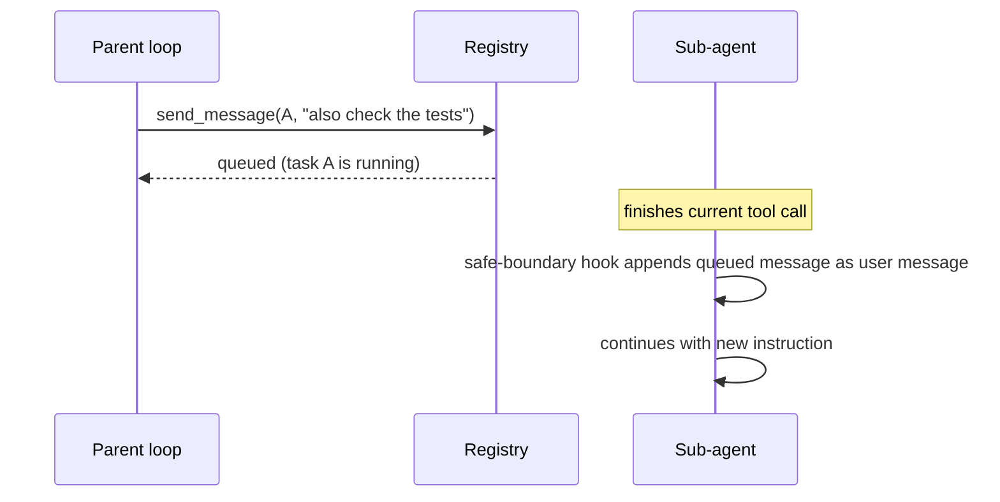
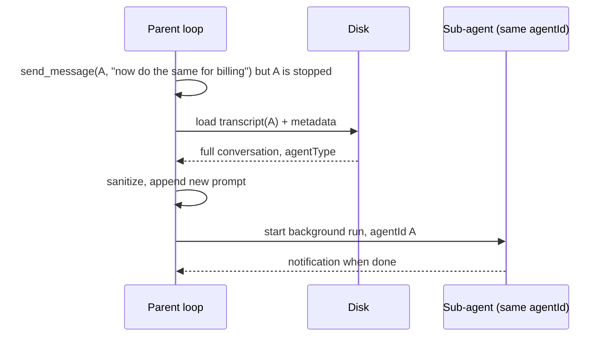

# Sub-agent platform contract

This document is a build contract for adding a sub-agent system to your application. It defines what the system must do, the data it must keep, and the guarantees it must never break. It is intentionally not an implementation guide: module names, internal structure, and libraries are your choice. If you satisfy every MUST in this document, your system will behave like the reference product.

Written for a developer building this for the first time. TypeScript-style types are used to describe shapes, but the contract is language-neutral.

## How to read this contract

- **MUST**: required. If you skip it, a listed acceptance test will fail or the system will corrupt state.
- **SHOULD**: strongly recommended. Skip only with a written reason you can defend later.
- **MAY**: optional.

## What you are building

Your application already has a main agent loop: the model chats with the user and calls tools. On top of that loop you will add four capabilities:

1. **Delegate.** The main (parent) agent can start a second agent (sub-agent) with its own system prompt, its own tool set, and one task. The parent can either wait for the result, or let it run in the background.
2. **Interject.** While a sub-agent is running, the parent can send it a message that arrives inside its conversation.
3. **Report back.** A sub-agent returns its result to the parent through a defined channel, whether the parent is waiting or not.
4. **Resume.** After a sub-agent has finished, the parent can send it more work and the sub-agent continues with everything it previously knew.

Everything else in this document exists to make those four capabilities safe.

## Core concepts

| Concept | Meaning |
| --- | --- |
| Agent definition | A reusable template: name, system prompt, allowed tools, model, permission level. Shipped built-ins plus user-defined files. |
| Parent agent | The existing main agent loop that owns the user's terminal or session. |
| Sub-agent | One running instance created from an agent definition, working on one task. Identified by an immutable `agentId` (UUID). |
| Task record | The parent's live view of a sub-agent: status, progress, cancellation handle, result. Kept in app state, not on disk. |
| Transcript | An append-only log of every message the sub-agent produced, on disk. This is the sub-agent's long-term memory. |
| Pending-message queue | Messages addressed to a running sub-agent, waiting to be delivered at a safe moment. |
| Completion notification | The envelope that tells the parent "this background agent finished, here is the result". Re-enters the parent as a user message. |
| Agent registry | A map from human-chosen names to agentIds so the parent can address an agent by name. |

## Modules you need

You do not have to organize code this way, but every piece must exist somewhere:

1. **Agent catalog**. Loads agent definitions from built-ins and from a user directory (one file per agent).
2. **Runner**. Starts a sub-agent: builds its isolated context and runs your existing agent loop with that context.
3. **Task registry**. Creates, updates, looks up, and evicts task records.
4. **Transcript store**. Appends messages to a per-agent log file and reads a full conversation back from it.
5. **Notification queue**. Holds completion notices and feeds them to the parent between turns.
6. **Send-message tool**. The tool your parent LLM calls to message or resume a sub-agent.
7. **Output tool**. The tool the parent LLM calls to poll or block on a task.
8. **Spawner tool**. The tool the parent LLM calls to start a sub-agent.

## Feature contracts

### F1. Delegating a task

The parent LLM gets a tool (call it `spawn_agent` in this document) with this shape:

```ts
type SpawnInput = {
  description: string      // 3-6 words, for UI and notifications
  prompt: string           // the task, becomes the first user message
  agentType?: string       // which definition to use, default "general-purpose"
  model?: string           // optional override of the definition's model
  runInBackground?: boolean
  name?: string            // optional, makes the agent addressable by name
}
```

Behavior:

- The system **MUST** reject an `agentType` that does not exist, with an error that lists the available types.
- The system **MUST** validate the definition's required integrations (for example, external tool servers) before starting, and fail fast with a clear message if they are unavailable.
- The spawned agent **MUST** get its own conversation containing exactly one initial user message: the `prompt`. It **MUST NOT** see the parent's conversation (see F6 for the one exception).
- A stable `agentId` **MUST** be created at spawn time and used for every later reference to this agent.

**Synchronous mode** (`runInBackground` false or omitted):

- The tool call stays open until the sub-agent finishes. The parent's turn is blocked.
- The tool result **MUST** contain the sub-agent's final answer text, its `agentId`, and usage totals (tokens, tool calls, duration).
- The result text **MUST** include a hint telling the model it can continue this agent later by sending a message to that `agentId`.
- If the user cancels the parent turn, the sub-agent **MUST** be cancelled too.

**Asynchronous mode** (`runInBackground` true):

- The tool call returns immediately with `status: "launched"`, the `agentId`, and a path to an output file the parent can read later.
- The sub-agent **MUST** keep running even if the user cancels the parent's current turn. It **MUST** be killable through an explicit action (a task panel, a stop command, or a cleanup handler on app exit).
- When it finishes, a completion notification is delivered (F4).

A sync agent **SHOULD** be convertible to async while it runs (a "background this task" action), because long sync agents freeze the parent. If you implement it, the converted agent keeps the same `agentId` and follows the async rules from that point on.

### F2. Isolation

- A sub-agent **MUST** run with its own context object, not the parent's. It gets: its own message list, its own tool set, its own file-state caches, and its own cancellation handle. Sharing mutable state with the parent is the number one source of corruption. Copy what you must share, do not reference it.
- The definition may declare a permission level. The effective level is the definition's, except the parent's more permissive levels always win.
- A background sub-agent has no terminal, so it **MUST NOT** be allowed to ask the user questions. Any tool that renders UI or blocks on user input **MUST** be excluded from background agents' tool sets.
- Tool restriction **MUST** be deny-by-default with an explicit allowlist for background agents: read, search, file edit, file write, shell, and nothing else to start with.

### F3. Messaging a running agent

The parent LLM gets a tool (call it `send_message`) with this shape:

```ts
type SendMessageInput = {
  to: string        // registered name, or a raw agentId
  message: string
}
```

Behavior:

- `to` **MUST** resolve through the registry first, then be treated as a raw agentId.
- If the target task is **running**, the message **MUST** be queued on the task record, and the tool returns immediately: "queued for delivery at the next safe point".
- Delivery: the queued messages **MUST** be injected into the sub-agent's conversation as ordinary user messages at a **safe boundary**. A safe boundary is between one tool call finishing and the next model request starting. Delivering mid-stream breaks in-flight API requests.
- Ordering **MUST** be preserved: messages are delivered in the order they were queued.
- If the target task is **stopped** (completed, failed, or killed), the system **MUST NOT** queue the message. It **MUST** resume the agent with the message as its new task (F5).
- If the task record no longer exists in memory (evicted), the system **MUST** still attempt the resume path from the on-disk transcript.
- If nothing is known about the target, the tool **MUST** return a clear failure saying so.

Practical note: the cleanest implementation of "safe boundary" is a hook that runs right before each new model request inside your agent loop. It collects any pending items for the current agent and appends them as user messages. One hook covers this and future injection features.

### F4. Reporting back

Four channels, all required:

1. **Direct return** (sync only). The sub-agent's final answer text becomes the tool result in the parent conversation.
2. **Completion notification** (async only). When a background agent reaches a terminal state, the system builds an envelope and puts it on the parent's queue:

```json
{
  "type": "task-notification",
  "taskId": "agent_9f2c...",
  "status": "completed",
  "summary": "Agent \"Fix login bug\" completed",
  "outputFile": "/path/to/transcript.jsonl",
  "result": "final answer text, may be empty",
  "usage": { "totalTokens": 8421, "toolUses": 12, "durationMs": 91000 }
}
```

   - Status is one of `completed`, `failed`, `killed`.
   - `result` **SHOULD** be the last thing the sub-agent said. For `killed`, it **SHOULD** be the best partial answer found in the transcript.
   - The parent **MUST** consume queued notifications between turns, submitting each as the next user message, so the model reacts to the finished agent. User input always takes priority over notifications.
   - Exactly-once: a task that has already been marked notified **MUST NOT** produce a second envelope. Use an atomic check-and-set flag on the task record.
3. **Progress** (both modes). While running, the parent's UI shows what the agent is doing. The mechanism is yours (events, state updates); the requirement is that each model message and tool call the sub-agent makes is observable live from the parent.
4. **Pull** (async only). The parent LLM gets an output tool: `get_task_output(taskId, block, timeoutMs)`. With `block: false` it returns current status immediately. With `block: true` it waits up to the timeout for a terminal state, then returns status plus result. If the parent retrieves the result this way, the task is marked notified so the queued envelope is suppressed as a duplicate.

### F5. Resuming with the same context

This is the feature that makes sub-agents feel like coworkers instead of one-shot functions. Contract:

- The trigger is any `send_message` to a stopped or evicted agentId.
- The system **MUST** load the agent's full transcript from disk and rebuild its conversation from it.
- The rebuild **MUST** drop incomplete exchanges: any assistant message whose tool calls never received results must be removed, along with orphaned artifacts. Replaying a broken conversation is rejected by model APIs.
- The new user message is appended after the rebuilt conversation. The agent then runs as a normal background agent.
- The `agentId` **MUST NOT change**. Resume is a continuation, not a clone. All future messages still address the same id.
- The agent definition used at spawn time **MUST** be recorded somewhere durable and reused on resume. If the definition no longer exists, fall back to the general-purpose definition and say so.
- When the resumed run finishes, a normal completion notification is delivered (F4).
- A resumed agent **MUST** behave as if the user had simply continued talking to it: it knows its original task, what it did, and its own last answer.

### F6. Parent-context handoff (optional)

You **MAY** offer a mode where the sub-agent starts with a copy of the parent's conversation plus the new task, for cases where the sub-agent needs full background. If you build it, three rules apply:

- It **MUST** be a copy. The sub-agent's writes never affect the parent conversation.
- The copy **MUST** be sanitized the same way as a resumed transcript (F5).
- A sub-agent started this way **MUST NOT** be able to spawn further sub-agents in the same mode, or you get exponential fan-out.

### F7. Recursion guard

- By default, sub-agents **MUST NOT** have access to the spawn tool. One level of delegation is the supported baseline.
- If you later allow nesting, cap the depth at a small constant and enforce it at spawn time, not by prompt instructions.

## Data contracts

### Task record (in-memory)

```ts
type TaskStatus = 'running' | 'completed' | 'failed' | 'killed'

type TaskRecord = {
  taskId: string                // same value as agentId
  agentType: string
  description: string
  prompt: string
  status: TaskStatus
  startedAt: number
  endedAt?: number
  cancel?: () => void           // cancels the agent
  result?: string                // final answer, on completion
  error?: string                 // on failure
  progress?: {
    toolCalls: number
    tokens: number
    currentActivity?: string    // "Reading src/auth.ts"
  }
  pendingMessages: string[]     // F3 queue
  notified: boolean             // F4 exactly-once flag
}
```

Task records are cache, not truth. The system **MAY** evict terminal task records from memory after a grace period. The transcript on disk is the truth and **MUST NOT** be deleted on eviction.

### Transcript (disk, append-only)

One JSONL file per agent. Each line:

```json
{
  "uuid": "m-104",
  "parentUuid": "m-103",
  "agentId": "agent_9f2c...",
  "role": "assistant",
  "content": [],
  "timestamp": "2026-10-07T12:00:00Z"
}
```

- Every message the sub-agent produces **MUST** be appended before it is surfaced anywhere else (write-ahead). If the process dies, the transcript is the recovery source.
- `uuid` and `parentUuid` form the conversation chain. To rebuild, walk backwards from the latest entry.
- Model-specific wrappers **SHOULD** be stripped on write so the file stays loadable after upgrades.

### Metadata sidecar (disk)

One small JSON file per agent, next to the transcript:

```json
{
  "agentType": "code-reviewer",
  "description": "Review the auth module",
  "workingDirectory": "/optional/isolated/copy"
}
```

`agentType` is required for resume routing. The other fields are conveniences.

### Output file

The system **SHOULD** expose the transcript file itself as the agent's "output file", so the parent can read progress and history with its normal file tools. A symlink or a stable path both work.

## Task state machine



Transitions are one-way except resume, which always re-enters `running` with the same identity.

## End-to-end walkthroughs

### Async spawn and completion



### Mid-run message



### Resume



## Invariants

These are the lines you never cross. Every one of them exists because breaking it produces a real, observed failure mode.

1. **Write-ahead.** A message is persisted to the transcript before it is yielded, returned, or displayed. Otherwise a crash loses the exact context that resume depends on.
2. **Stable identity.** An agent's id never changes across resume. Everything (messaging, registry, transcript paths) keys off it.
3. **Disk is truth.** In-memory task state can be rebuilt or evicted. The transcript cannot. Never delete a transcript as part of state cleanup.
4. **No shared mutable context.** Sub-agents copy what they need. Two agents writing through one context object is how both get corrupted.
5. **Safe-boundary delivery.** Queued messages only enter the conversation between tool rounds. Never during a model call in flight.
6. **Exactly-once notification.** Check-and-set the notified flag atomically before enqueueing.
7. **Cancellation symmetry.** Sync agents die with the parent's turn. Async agents survive it and die only by explicit kill or cleanup.
8. **Sanitize on replay.** Any conversation reloaded from disk (resume, parent-context handoff) is filtered for unresolved tool calls before it touches a model API.
9. **Partial beats silent.** On error or kill, return whatever the agent managed to say plus the error. Never drop a terminal event on the floor.
10. **Background agents cannot prompt the user.** Their tool set excludes anything that renders UI or waits for input.

## Acceptance tests

Implement these as integration tests. All ten must pass before you call the feature done.

1. **Sync spawn.** Given a running parent, when it spawns a sync agent, then the parent's turn blocks, and the tool result contains the agent's final text, its agentId, and usage.
2. **Async spawn.** Given a spawn with `runInBackground`, then the tool returns immediately with agentId and output file, and the agent is running while the parent continues.
3. **Notification.** Given a finished background agent, when the parent's turn ends, then exactly one notification is submitted as the next user message, containing status, result, and usage.
4. **No duplicate notification.** Given the parent polled the task to completion with the output tool, when the notification would have been delivered, then it is suppressed.
5. **Queue then deliver.** Given a running agent, when the parent sends it a message, then the tool returns "queued", and the message appears in the agent's transcript as a user message after its current tool call completes, in order.
6. **Message to stopped agent resumes it.** Given a completed agent, when the parent sends it a message, then it starts running again with the same agentId, its transcript contains both the old and new conversation, and a second notification arrives on completion.
7. **Resume after eviction.** Given a completed agent whose task record was evicted from memory, when the parent sends its agentId a message, then the system loads the transcript from disk and resumes normally.
8. **Kill.** Given a running background agent, when it is explicitly stopped, then its status is `killed`, a killed notification with the best partial answer is queued, and its process or loop stops.
9. **Crash recovery.** Given an agent mid-run when the process exits, when the app restarts, then the transcript on disk contains every message the agent produced before the exit.
10. **No recursion.** Given any sub-agent, its tool list does not include the spawn tool.

## Common pitfalls

Each of these is a real bug class. Read this list again after your first working prototype.

- **Notification storms.** Two code paths both enqueue completion notices. Always route through one function that owns the notified flag.
- **Eviction deletes the transcript.** Your cleanup for "old tasks" must only remove in-memory records. Deleting the log file silently breaks resume forever.
- **Mid-stream injection.** Appending a queued message while the model is streaming, or between an assistant's tool call and its result, produces a structurally invalid conversation. Always inject at the safe boundary.
- **Replaying broken conversations.** A crash between tool call and tool result leaves the transcript half-finished. The resume path must strip incomplete exchanges, not trust the file.
- **Freezing the main loop.** Every sync agent holds the user's turn. Default to background for anything expected to take more than a few tool calls, and make sync agents convertible to background.
- **Untracked cleanup.** If the app exits with agents running, register a cleanup handler, or you leak processes and half-written transcripts.
- **Trusting the model with identity.** The agentId hint in tool results is how the model learns to continue agents. Keep the format short and consistent, and never change it mid-release.

## Out of scope for v1

Do not build these in the first pass. They are listed so you recognize them later:

- Multi-agent teams with peer mailboxes, broadcast, and shared rosters.
- Filesystem isolation (git worktrees or directory copies) per agent.
- Prompt-cache-identical forking where the child shares the parent's exact prompt prefix.
- Periodic background progress summaries generated by a second model call.
- User-defined agents with hooks and per-agent external tool servers.

## Suggested build order

1. Agent catalog + spawn tool, sync only. Result returns as a tool result. Transcript written.
2. Task registry + async spawn. Return "launched", keep the agent alive independently.
3. Notification queue + between-turns delivery in the parent loop.
4. Send-message tool, queue only (no delivery yet), plus the registry.
5. Safe-boundary delivery hook inside your agent loop.
6. Resume from transcript, including the sanitizer. Acceptance tests 6, 7, 9.

Steps 1 through 3 give you a usable background-worker feature. Steps 4 through 6 are what make it feel like talking to one continuous agent.
